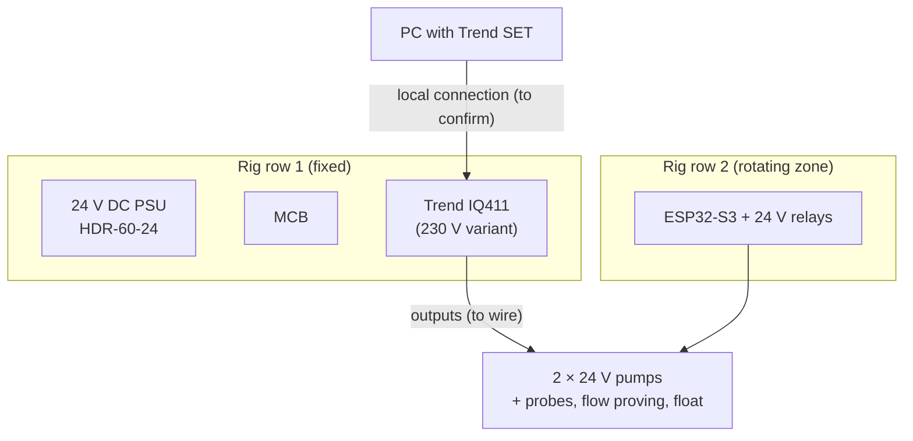

# Trend IQ411 Commissioning: Real DDC on the Training Rig (Planned)

**Putting a real Trend IQ411 controller (a widely used UK BMS outstation) onto the training rig: power-up and addressing, I/O commissioning, writing strategy in Trend's System Engineering Tool (SET), then re-implementing the rig's duty/standby, interlock and PID sequences in Trend strategy and comparing them with the ESP32 versions. The aim is hands-on Trend experience, not just theory.**

> **The short version:**
> - **Hardware:** a Trend IQ411 (230 V mains variant) on row 1 of the DIN-rail rig, on its own MCB.
> - **Commissioning:** power, addressing, comms to SET ⟨connection method to confirm for this model⟩, then I/O point-to-point checks.
> - **Strategy:** duty/standby (#7), interlocks (#9) and a PID loop (#8) written in Trend strategy modules: sensors, knobs, switches, loops, logic, drivers, time zones.
> - **Comparison:** the same sequences on ESP32/ESPHome vs Trend: engineering effort, behaviour, diagnostics.

**Portfolio position:** Field/automation level · vendor DDC (portfolio #12). PLC counterpart: [PLC re-implementation](https://github.com/the-control-cabinet/plc-reimplementation-iec61131) (#13). Rig companions: [duty/standby + interlocks](https://github.com/the-control-cabinet/din-rail-rig-duty-standby-interlocks) · [PID rig](https://github.com/the-control-cabinet/pid-anti-hunt-control-rig)

---

## Status at a glance

| Item | Status |
|---|---|
| Controller mounted on the rig (row 1, own MCB, 230 V variant) | ✅ Fitted |
| Hardware and comms record | 📐 Template ([doc 01](docs/01-hardware-and-comms.md)): I/O and comms details to record from the datasheet |
| Commissioning procedure | ✅ Written ([doc 02](docs/02-commissioning.md)) |
| Strategy design (module by function) | 📐 Drafted ([doc 03](docs/03-strategy.md)) |
| SET access, power-up, point-to-point, strategy download, functional tests | ⏳ To do |

## Why a Trend controller

Trend is one of the most common BMS controller families in UK commercial buildings. Engineering one by hand (addressing, point-to-point checks, writing strategy in its modules, then proving it against a written sequence) is the core of a BMS engineer's job. Doing it on a rig whose sequences already exist on an ESP32 means the result can be **compared**, not just completed.

## Where it sits on the rig

## Commissioning sequence

1. **Pre-power checks:** wiring against the drawing; mains segregation; terminals torqued; insulation and continuity on the 24 V side.
2. **Power up:** status LEDs; set the address; connect SET.
3. **Point-to-point:** every input and output against the I/O schedule (simulate with a calibrator or resistor box; force outputs).
4. **Strategy download:** check against the written sequence.
5. **Functional tests:** the rig's existing test record (duty/standby, interlocks, PID), so results compare directly with the ESP32 and the PLC.
6. **Handover record:** I/O schedule, strategy printout, test results.

## Strategy: the same sequences in Trend modules

| Function | Trend approach |
|---|---|
| Inputs | Sensor modules (scaling, alarm limits) |
| Setpoints and adjustments | Knob modules |
| Pump enables | Switch + logic modules; driver modules to outputs |
| Duty/standby | Logic for lead selection by run hours; failover on a proving input |
| Interlocks | Logic gating the drivers (permissives, latched lockout) |
| PID | Loop module (proportional band, integral time; its anti-windup behaviour documented) |
| Schedules | Time zone modules |

## Comparison it feeds

The same rig logic exists on three platforms: ESPHome on an ESP32, this Trend IQ411, and an IEC 61131-3 PLC. The [three-platform comparison](https://github.com/the-control-cabinet/plc-reimplementation-iec61131/blob/main/docs/03-three-platform-comparison.md) records engineering effort, behaviour against the same tests, diagnostics and change control.

## Open items before power-up

- I/O count and types from the IQ411 datasheet (into the [I/O schedule](data/iq411-io-schedule.csv)).
- **SET access first:** Trend's engineering tools have generally been licensed through its partner network, so confirm the version and licence route (a Trend partner or distributor) before the strategy work depends on it. The IQ4 family's **built-in web interface** covers basic set-up and point checks meanwhile.
- **BACnet/IP:** check whether this model and firmware support it. If so, the controller can also be read by the [BACnet/IP explorer](https://github.com/the-control-cabinet/bacnet-ip-network-explorer) (YABE and Home Assistant) and by Niagara.
- PC connection method and network options (Trend LAN / BACnet) for this model and firmware.

## Documents

| Doc | Contents |
|---|---|
| [01 Hardware and comms](docs/01-hardware-and-comms.md) | Power, addressing, SET connection, I/O schedule |
| [02 Commissioning procedure](docs/02-commissioning.md) | Point-to-point checks, strategy download, functional tests |
| [03 Strategy design](docs/03-strategy.md) | Duty/standby, interlocks and PID in Trend modules |

## Roadmap
- [ ] Record the IQ411 I/O and comms details from the datasheet
- [ ] Source or confirm SET access (Trend partner route); meanwhile, the IQ4 web interface
- [ ] Check BACnet/IP support on this firmware
- [ ] Power up, address and connect
- [ ] Point-to-point I/O commissioning
- [ ] Strategy: duty/standby → interlocks → PID
- [ ] Comparison write-up vs ESP32
- [ ] Supervisor view: the IQ411 in Niagara (Trend driver), part of the Niagara familiarisation via the Niagara 4 TCP

## Skills demonstrated (as built)
| Skill | Evidence |
|---|---|
| Vendor DDC | Trend IQ411 hands-on |
| Commissioning | Point-to-point I/O, strategy download, functional tests |
| Trend strategy | Sensors, knobs, switches, loops, logic, drivers, time zones |
| Platform comparison | Same sequences on ESPHome vs Trend |

📺 [The Control Cabinet on YouTube](https://www.youtube.com/channel/UC5Cupmz7vlfcodpCX7k8iuQ)

*Built and documented by James · part of [The Control Cabinet BMS portfolio](https://github.com/the-control-cabinet/the-control-cabinet). MIT Licence.*
